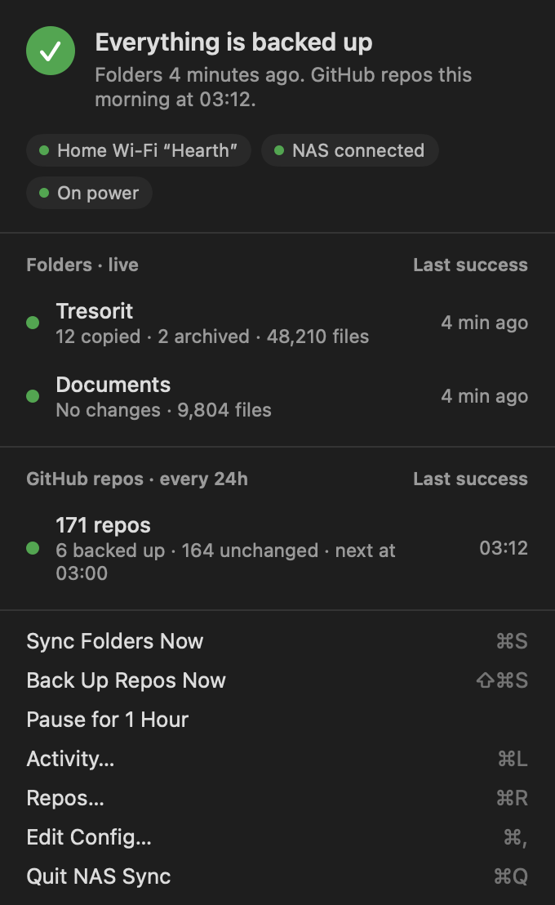
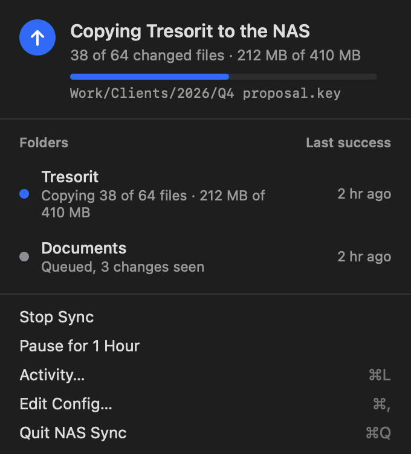
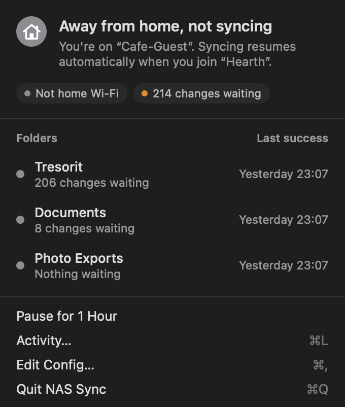
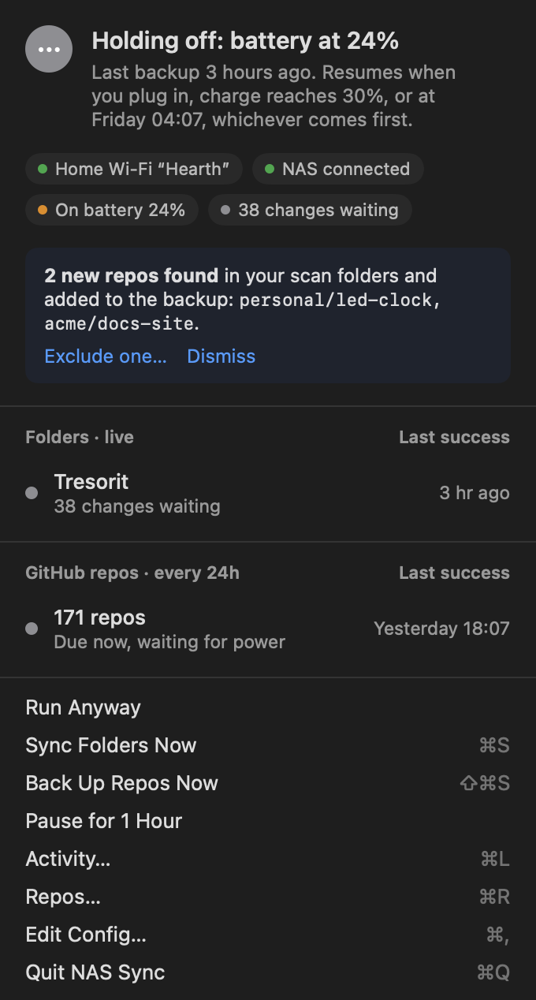
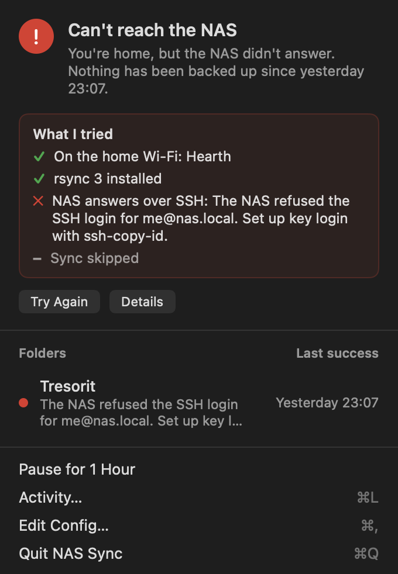
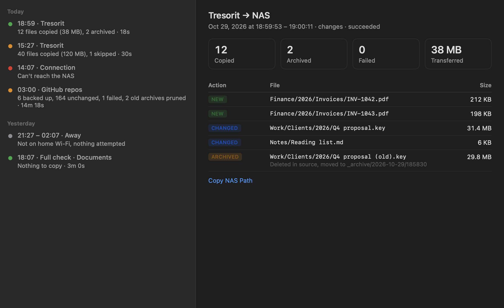
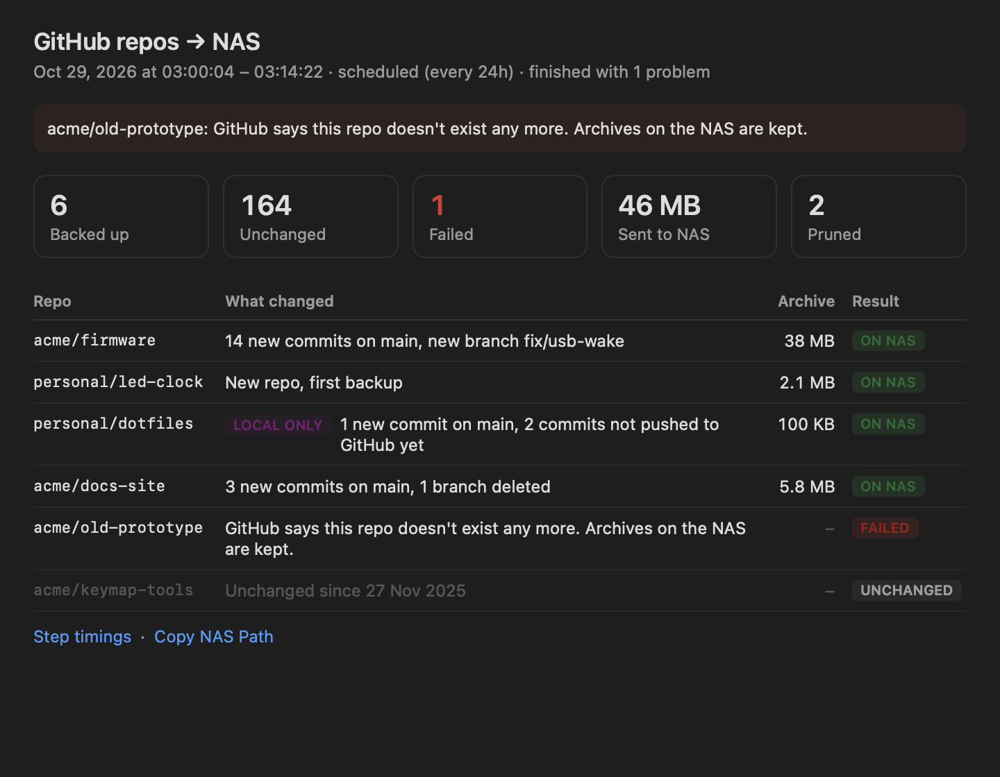
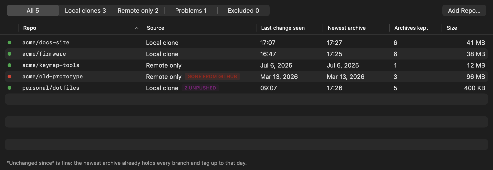
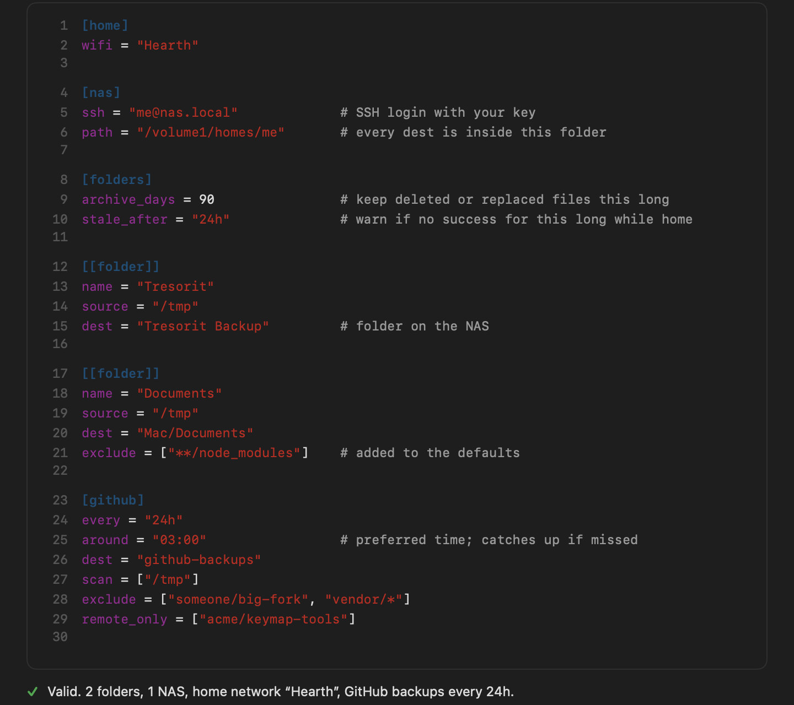

# NAS Sync

NAS Sync is a macOS menu bar app that backs up your folders and your GitHub repos to a NAS on your home network. It only does this when your Mac is on your home Wi-Fi. Away from home it waits and keeps track of what changed. When you get back, it catches up on its own.

<p align="center">
  
</p>

## Why it exists

A laptop is a bad place to keep the only copy of anything. A NAS at home is a good second place, but getting files onto it reliably usually takes a sync app and some scripts held together by habit. Each piece breaks in its own way, and you don't notice until you need a file.

NAS Sync does the whole job in one small app:

- Folders are copied one way to the NAS shortly after they change. Your Mac is never modified.
- Deleting or overwriting a file on your Mac doesn't lose it on the NAS. The old version moves to a dated `_archive` folder and stays there for as long as you choose.
- GitHub repos are backed up as single compressed git bundles, with daily, weekly and monthly copies kept. Repos on your Mac are backed up from your Mac, so commits you haven't pushed and branches that only exist locally are included.
- On someone else's network it does nothing and says so. On battery with a low charge it waits, but never longer than you allow.
- You get a notification when something breaks, when it recovers, or when a backup hasn't succeeded for too long. Otherwise you can forget it's there.
- All settings live in one text file. You can edit it by hand, keep it with your dotfiles, or ask an LLM to change it. The app reloads it when you save and points out mistakes with line numbers.

It copies with rsync over SSH, which is fast even over Wi-Fi. On the setup it was built for, checking a folder of about 480,000 files against the NAS takes under half a minute when little has changed.

## What it looks like

The menu bar icon opens a summary of what's happening and why.

<table>
  <tr>
    <td align="center" width="50%"><br><sub>Copying changes, with progress</sub></td>
    <td align="center" width="50%"><br><sub>Away from home: changes are counted, nothing is sent</sub></td>
  </tr>
  <tr>
    <td align="center"><br><sub>Holding off on a low battery, and new repos it found</sub></td>
    <td align="center"><br><sub>When the NAS doesn't answer, it shows what it tried</sub></td>
  </tr>
</table>

Activity lists every run. Click one to see each file that was copied, changed or archived.



GitHub runs explain why each repo was or wasn't backed up.



The Repos window shows every repo it knows about, where it comes from and how many copies are on the NAS.



## How it works

### Folders

Each folder you list in the config is a job with a source on your Mac and a destination folder on the NAS.

1. The app watches the source with macOS file system events. When something changes, it waits until the folder has been quiet for a short while (30 seconds by default), so a save in progress isn't copied halfway.
2. It runs rsync over SSH. rsync compares the folder with the NAS copy by size and modification time and sends only what differs.
3. A file that was changed or deleted on your Mac isn't simply overwritten or removed on the NAS. rsync moves the old copy into `_archive/<day>/<time>/` inside the job's folder, keeping its path, so several versions from the same day can sit side by side.
4. Archive folders older than `archive_days` (90 by default) are deleted.

Once a day, at `nightly_check`, it compares every folder in full in case an event was missed. If a folder changes constantly and you'd rather not sync every few minutes, `at_most_every = "1h"` limits it to once an hour.

Before changing anything, a run checks a few things and stops if one looks wrong:

- the source folder is missing (an unplugged drive, for example)
- the source folder is empty but the NAS copy isn't
- the run would archive more than `max_delete_percent` of the backup or more than `max_delete_files` files

In the last case the menu asks you to confirm, and you can allow that one run. Files are written under a temporary name and renamed when complete, so a half-copied file never replaces a good one.

### GitHub repos

Once a day, around the time you set, the app goes through your repos.

It finds them in two ways. It searches the folders listed in `scan` for git repos whose remote is on GitHub. It also backs up the repos listed in `remote_only`, which you don't have on your Mac; it keeps a hidden copy of each and downloads updates from GitHub before backing it up.

For each repo it reads where every branch and tag points (and your stash, for repos on your Mac) and compares that with the last run. If nothing moved and the newest copy is still on the NAS, the repo is skipped. Otherwise the app writes down what changed, such as "3 new commits on main, new branch fix/x, 2 commits not pushed to GitHub yet", and makes a new copy:

1. `git bundle create --all` packs every branch, tag and commit into one file.
2. `git bundle verify` checks that the file is complete.
3. xz compresses it.
4. rsync sends it to the NAS. The NAS then checksums the copy with SHA-256. If it doesn't match the file on the Mac, the copy is deleted and the repo is marked as failed.

Copies land in `github-backups/bundles/<group>/<repo>/YYMMDD-owner-repo.bundle.xz`. Groups sort repos into folders by owner.

After a new copy, older ones are pruned. By default each repo keeps the three newest, one from the past week, one from the past month and one between two months and a year old, up to six in total. The last copy of a repo is never deleted, and nothing is pruned for a repo that has disappeared from GitHub or from your Mac.

Each run also leaves a short report in `github-backups/reports` on the NAS, kept for 90 days.

### Home, battery and notifications

The app reads the Wi-Fi network name to decide whether you're home. macOS only shares that name with apps that have Location permission, which is why the app asks for it. It doesn't use your location for anything else.

When you're home, it checks that the NAS answers over SSH before running anything. If it doesn't, the menu shows a checklist of what it tried, and the app tries again every few minutes and whenever the Mac wakes up.

On battery, it waits while the charge is below `hold_below_percent`. If the last backup is older than `but_not_longer_than`, it runs anyway.

You get a notification when a backup fails, when it starts working again, and when a job hasn't succeeded for longer than `stale_after` while you were home.

## Why there are no releases

NAS Sync is meant as a code base you build and adapt, not a packaged product, so there are no downloads.

There are practical reasons too. An app downloaded from the internet has to be signed with a paid Developer ID and notarized by Apple, or macOS refuses to open it without a fight. macOS also ties the permissions this app needs, such as Location and Full Disk Access, to whoever signed it. When you build it with your own Apple account, the permissions you grant survive rebuilds and nobody else's certificate is involved.

Building it takes a few minutes. Any Apple account signed in to Xcode will do; you don't need a paid developer membership to run it on your own Mac.

## Requirements

- macOS 26 or later
- Xcode 26 or later
- rsync 3 on your Mac: `brew install rsync`. The `rsync` that ships with macOS is a different program (openrsync) and lacks options the app uses.
- A NAS you can reach over SSH with a key, with rsync installed on it. Synology and most other NAS systems have both; on a Synology, turn on SSH under Control Panel > Terminal & SNMP.
- For GitHub backups: `git` (the one from Xcode's command-line tools is fine) and an SSH key that can read your repos.

## Setup

### 1. Set up SSH login to the NAS

The app signs in with your SSH key and never asks for a password. If you don't have a key yet, create one with `ssh-keygen -t ed25519`. Then copy it to the NAS:

```sh
ssh-copy-id -p 22 you@nas.local
```

Change the port if your NAS uses a different one. Then connect once by hand, accept the NAS's host key when asked, and check that no password prompt appears:

```sh
ssh -p 22 you@nas.local 'echo ok'
```

On a Synology, the user needs a home folder (Control Panel > User & Group > Advanced > Enable user home service) and must be allowed to use SSH, which in practice means being in the administrators group.

### 2. Build the app

1. Clone this repo.
2. Copy `App/Local.xcconfig.example` to `App/Local.xcconfig` and fill in your team ID and a bundle ID of your own. Xcode shows your team ID under Settings > Accounts. This file is ignored by git.
3. Open `App/NASSync.xcodeproj` and run the **NAS Sync** scheme, or build from a terminal:
   ```sh
   xcodebuild -project App/NASSync.xcodeproj -scheme "NAS Sync" -configuration Release -derivedDataPath build/DerivedData build
   ```
4. Move `build/DerivedData/Build/Products/Release/NAS Sync.app` to `/Applications` and open it from there.

The Xcode project is generated from `App/project.yml` with [XcodeGen](https://github.com/yonaskolb/XcodeGen). If you change `project.yml`, run `xcodegen generate` in `App/`.

### 3. First launch

The app asks for a few permissions:

- Location, so it can read the Wi-Fi name. Without it the app always thinks you're away.
- Notifications, so it can tell you when something breaks.
- Local Network, which macOS asks for the first time the app contacts the NAS.
- Full Disk Access, only if a folder you back up is protected, such as Desktop, Documents or a cloud drive folder. Settings > Permissions has a button for it.

Settings opens and offers to create a starter config at `~/.config/nas-sync/config.toml`. Fill in your Wi-Fi name, your NAS login and the folders you want backed up, then save. Finally, turn on Launch at login in Settings.

## Configuration

Everything is in one TOML file. Times look like `"30s"`, `"15m"`, `"12h"` or `"2d"`, and paths may start with `~`. The app reloads the file when you save it. If you save a mistake, it keeps running on the last valid version and shows what's wrong, with line numbers.



A complete example:

```toml
[home]
wifi = "MyHomeWiFi"                 # only sync on this network

[nas]
ssh = "me@nas.local"                # SSH login (key login, no password)
port = 22
path = "/volume1/homes/me"          # base folder on the NAS; every dest is inside it

[battery]
hold_below_percent = 30
but_not_longer_than = "12h"

[folders]                           # defaults for every [[folder]]
archive_days = 90
stale_after = "24h"
quiet_period = "30s"
nightly_check = "03:00"

[[folder]]
name = "Documents"
source = "~/Documents"
dest = "Mac/Documents"              # folder inside nas.path
exclude = ["**/node_modules"]

[[folder]]
name = "Cloud drive"
source = "~/Library/CloudStorage/SomeDrive"
dest = "Cloud Backup"
at_most_every = "1h"                # the cloud app already watches these files

[github]
every = "24h"
around = "03:00"
dest = "github-backups"
scan = ["~/Code"]                   # local clones found here
remote_only = ["someone/repo"]      # repos with no local clone
exclude = ["someone/big-fork"]
groups = { "my-org" = "my-org", "*" = "other" }
```

### `[home]`

| Setting | Meaning |
| --- | --- |
| `wifi` | The name of your home Wi-Fi network. Nothing syncs on any other network. |

### `[nas]`

| Setting | Default | Meaning |
| --- | --- | --- |
| `ssh` | | The SSH login, `user@host`. |
| `port` | `22` | The SSH port. |
| `path` | | The base folder on the NAS. Every `dest` is a folder inside it. |
| `rsync` | Homebrew's | Path to rsync 3 on your Mac, if it isn't in `/opt/homebrew/bin` or `/usr/local/bin`. |
| `remote_rsync` | `/usr/bin/rsync` | Path to rsync on the NAS. Synology only accepts the full path. |

### `[battery]`

| Setting | Default | Meaning |
| --- | --- | --- |
| `hold_below_percent` | `30` | On battery, wait while the charge is below this. |
| `but_not_longer_than` | `12h` | Run anyway once the last backup is older than this. |

### `[folders]` and `[[folder]]`

`[folders]` holds defaults for every job. Each `[[folder]]` is one job and can override most of them.

| Setting | Default | Meaning |
| --- | --- | --- |
| `name` | | A short name shown in the app. |
| `source` | | The folder on your Mac. |
| `dest` | | The folder on the NAS, inside `nas.path`. |
| `enabled` | `true` | Set to `false` to pause a job without deleting it. |
| `exclude` | see below | Patterns to skip. A job's list is added to the defaults. |
| `archive_days` | `90` | How long replaced and deleted files stay in `_archive`. |
| `stale_after` | `24h` | Warn if the job hasn't succeeded for this long while you were home. |
| `quiet_period` | `30s` | Wait for changes to settle before copying. |
| `at_most_every` | off | Sync changes at most this often. |
| `max_delete_percent` | `20` | Stop and ask if a run would archive more than this share of the backup. |
| `max_delete_files` | `1000` | Stop and ask if a run would archive more than this many files. |
| `nightly_check` | `03:00` | When to compare every folder in full. Set in `[folders]` only. |

The default excludes cover macOS clutter (`.DS_Store`, `._*`, `Icon\r`, trash and temporary folders), Office lock files (`~$*`), `*.tmp`, leftovers from SMB (`.smbdelete*`) and Synology's `@eaDir` and `#recycle` folders. Patterns follow rsync's rules: `node_modules/` matches a folder with that name anywhere, and `/build/` only matches one at the top of the source.

### `[github]`

| Setting | Default | Meaning |
| --- | --- | --- |
| `every` | `24h` | How often to run. |
| `around` | | Preferred time of day. A missed run catches up later. |
| `stale_after` | `48h` | Warn if no run has succeeded for this long while you were home. |
| `dest` | `github-backups` | Folder on the NAS, inside `nas.path`. |
| `scan` | `[]` | Folders to search for local clones. |
| `remote_only` | `[]` | `owner/repo` names to back up straight from GitHub. |
| `exclude` | `[]` | Repos to skip. `owner/*` works. |
| `new_repos` | `include` | Whether newly found clones are backed up (`include`) or only reported (`ignore`). |
| `groups` | `{ "*" = "other" }` | Which NAS folder each owner's repos go in. `*` catches the rest. |
| `gc` | `false` | Run `git gc` on local clones before bundling. |

How many copies to keep goes in `[github.keep]`, with `daily = 3`, `weekly = 1`, `monthly = 1`, `quarterly = 1` and `max = 6` as the defaults.

## Using it

Most of the time there's nothing to do. The menu bar icon shows the overall state, and clicking it shows each job and when it last succeeded. From the menu you can:

- sync folders now (⌘S) or back up repos now (⇧⌘S)
- pause everything for an hour
- run anyway while it's holding off for the battery
- stop a run in progress
- confirm a run that stopped at the safety limit
- open Activity (⌘L), Repos (⌘R) or the config (⌘,)

When it finds a new repo in your scan folders, the menu says so and offers to exclude it.

### Getting files back

Folder backups are plain files on the NAS, so you can copy them back with Finder, your NAS's file manager, `scp` or `rsync`. Older versions are under `_archive/<day>/<time>/` in the same folder, at the same path they had in the source.

A GitHub copy turns back into a repo in two steps:

```sh
swift run nas-sync unpack 261029-owner-repo.bundle.xz    # or: xz -dk 261029-owner-repo.bundle.xz
git clone 261029-owner-repo.bundle repo
```

The clone has every branch and tag that existed when the copy was made.

## Command-line tool

`swift build` also builds `nas-sync`, which shares the engine with the app. Use it to check a config, see what a run would do before letting it, or follow the app from a terminal.

```sh
swift run nas-sync validate                    # check the config
swift run nas-sync check                       # check that the NAS answers over SSH
swift run nas-sync diagnose                    # step through the connection checklist
swift run nas-sync status                      # what the app is doing (add --json for scripts)
swift run nas-sync watch                       # follow the app live: status changes and finished runs
swift run nas-sync run folders --dry-run       # show what a full check would copy and archive
swift run nas-sync run folders --dry-run --allow-mass-delete -v   # list everything, even past the safety limits
swift run nas-sync run github --dry-run -v     # show which repos would be backed up and why
```

## Troubleshooting

**"Can't reach the NAS."** The checklist in the menu shows which step failed, and `swift run nas-sync diagnose` runs the same steps in a terminal. The usual causes are an SSH key the NAS doesn't accept (run `ssh-copy-id` again), a host key you haven't accepted yet (connect once with `ssh`), or a wrong port.

**"NAS Sync needs rsync 3 on this Mac."** Install it with `brew install rsync`. If it lives somewhere unusual, set `rsync` under `[nas]`.

**It always says you're away.** The app doesn't have Location permission, or `wifi` in the config doesn't match the network name exactly.

**A folder fails with a permission error on your Mac.** Grant Full Disk Access in System Settings > Privacy & Security, then restart the app.

**A run stopped at the safety limit.** Look at the run in Activity, or run `swift run nas-sync run folders --dry-run --allow-mass-delete -v` to see every file it would archive. If the list is what you expect, confirm from the menu.

## Development

```sh
swift test       # unit tests; they use throwaway folders and git repos, and the folder tests need rsync 3
```

In a Debug build, `"NAS Sync.app/Contents/MacOS/NAS Sync" --render-samples <folder>` renders every screen with made-up data to PNG files without syncing anything. The screenshots in this README come from there.

Code layout:

- `Sources/SyncCore`: config parsing, folder sync, GitHub backups, the SSH connection, scheduling and the engine that ties them together
- `Sources/nas-sync`: the command-line tool
- `App`: the SwiftUI menu bar app
- `scripts/check-private.sh`: an optional pre-commit hook that blocks commits containing strings listed in a git-ignored `.private-patterns` file

## License

MIT. See [LICENSE](LICENSE).
